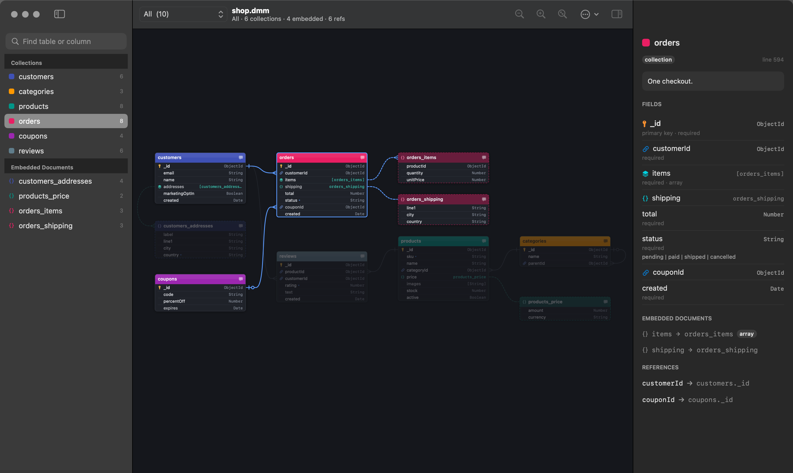
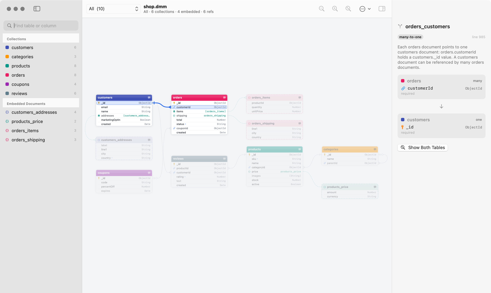
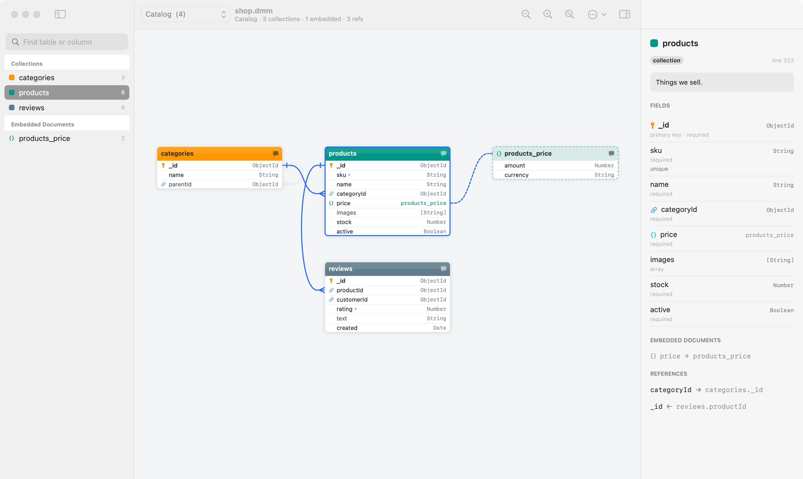

# MongoGram

A fast, native macOS viewer for MongoDB models made in [Moon Modeler](https://www.datensen.com/data-modeling/moon-modeler-for-databases.html)
(`.dmm` files). It is the `.dmm` sibling of [DBGram](https://github.com/n1klion/dbgram), which does the same for DBML.

Moon Modeler gets slow with big models. MongoGram opens the same `.dmm` file and draws it natively, so panning,
zooming and switching diagrams stay smooth with hundreds of collections. Tables appear where you placed them in
Moon Modeler, with the same widths and colors.



> MongoGram only **reads** `.dmm` files. It is an independent project and is not affiliated with Datensen or Moon Modeler.
> Use Moon Modeler to edit models and generate code.

## Features

- **Fast.** Each table is drawn once into a cached Core Animation layer, so pan, zoom and drag only move GPU
  textures. A 12 MB model with 2,200 tables parses in about 150 ms (release build).
- **Your layout.** Positions, box widths and header colors come from the file. Every diagram (the main one and
  each sub-diagram) is listed in the toolbar picker. Switch with ⌘[ / ⌘].
- **Live reload.** Save in Moon Modeler (or edit the JSON) and every open window updates. Tables moved in
  Moon Modeler move here too, unless you dragged them in MongoGram (⌘⇧R goes back to the file's layout). A half-written file never blanks the window: the last good version stays on screen.
- **Embedded documents.** Embeddable objects are drawn as dashed boxes tinted with their collection's color,
  joined to their field by a dashed line, with a crow's foot for arrays.
- **References you can inspect.** Click a line to highlight it and both fields, and read it in plain words:
  many-to-one, optional (nullable foreign key), or "array of subdocuments".
- **Notes everywhere.** Hover a field or a table header to read its comment or description. The inspector
  shows fields with required/array flags, embedded documents, references and indexes.
- **Model checks.** Problems are listed with their JSON line numbers: broken relation or containment-line
  references, embedded types that don't exist, missing containment lines, an embeddable shared by several
  parents, duplicate field names, `gHeight` that doesn't match `27 + fields × 18`.
- **Auto layout in three styles** (the Arrange button in the toolbar, or ⌘⇧L):
  - **Left to Right:** referenced collections on the left, the collections pointing at them on the right,
    folded to fit the screen.
  - **Pipeline:** one left-to-right flow along the references. Each collection is a stage, with its
    embedded documents beside it.
  - **Compact:** as little empty space as possible. Each collection keeps its embedded documents next to it,
    and collections that reference each other stay close.

  Each file remembers its style. **Use Layout from File** (⌘⇧R) goes back to Moon Modeler's positions.
- **Multi-select.** Drag a rectangle on the background, or ⌘/⇧-click tables on the canvas or in the sidebar,
  then drag them together or nudge them with the arrow keys. The inspector lists the selection and the lines
  between the selected tables.
- **Undo any move.** ⌘Z / ⌘⇧Z undo and redo drags, group drags, arrow-key nudges, auto-arrange and
  Use Layout from File. Undoing a move made on another diagram switches back to that diagram.
- **Mongoose export** (⌘⇧M, or **Copy Mongoose Schema**). It writes the whole model as Mongoose schemas (no models) in
  CommonJS, ES module or TypeScript:
  - Each embeddable becomes a sub-schema, with `{ _id: false }` unless it has its own `_id`. Sub-schemas come before the schemas that use them.
  - `nn` becomes `required`, a list becomes an array, and each relation becomes `ref: '<collection>'`.
  - Only schemas are written, no models. Each collection schema sets the `collection` option, so a model built from it keeps the name from the file instead of a pluralized one.
  - Descriptions and comments are kept as comments, and the TypeScript output exports `InferSchemaType` types.
  - Duplicate fields, unknown types and names Mongoose reserves are flagged in comments.
- **Light and dark mode**, PNG export, find (⌘F), and paste a model's JSON from the clipboard.

| Click a reference | Sub-diagrams |
| --- | --- |
|  |  |

## Install

Build it from source (below), then move `build/MongoGram.app` to `/Applications`, or run
`scripts/build-app.sh --install`.

MongoGram registers as an **alternate** app for `.dmm`, so Moon Modeler stays the default. Use
**Open With → MongoGram**, or `open -a MongoGram model.dmm`.

Requires macOS 14 or later.

## Controls

| Action | How |
| --- | --- |
| Pan | two-finger scroll, space + drag, or right-drag |
| Zoom | pinch, ⌘/ctrl + scroll, mouse wheel, ⌘= / ⌘- |
| Fit / 100% | ⌘0 or `F` / ⌘1 |
| Switch diagram | toolbar picker, ⌘[ / ⌘] |
| Find a collection or field | ⌘F, then Enter |
| Focus a table | double-click it, or click it in the sidebar |
| Inspect a line | click it; double-click to zoom to both tables |
| Move a table | drag it. This is saved per file and diagram in `~/Library/Application Support/MongoGram`; the `.dmm` is never written. |
| Select several tables | drag a rectangle on the background (⇧ adds to the selection), ⌘-click or ⇧-click (canvas or sidebar), ⌘A |
| Move the selection | drag any selected table, or arrow keys (⇧ = 10 pt) |
| Undo / redo a move or an auto-arrange | ⌘Z / ⌘⇧Z |
| Re-arrange everything | ⌘⇧L or the Arrange button (its arrow picks Left to Right, Pipeline or Compact) |
| Back to the file's layout | ⌘⇧R |
| Paste a model from the clipboard | ⌘⇧V |
| Export PNG | ⌘⇧E |
| Export Mongoose schema | ⌘⇧M |
| Clear the selection | Esc |

## Build from source

Tested with Xcode 26 (Swift 6).

```sh
scripts/build-app.sh              # -> build/MongoGram.app
scripts/build-app.sh --install    # also copies it to /Applications
scripts/build-app.sh --universal  # Apple Silicon + Intel binary
```

Development:

```sh
swift run MongoGram samples/shop.dmm
swift test
scripts/screenshots.sh            # regenerates the images in docs/images
scripts/make-samples.py           # regenerates samples/*.dmm
scripts/gen-stress.py 1500 2000 > /tmp/stress.dmm
```

Render diagrams to PNG without opening a window:

```sh
MongoGram --render model.dmm out.png [--diagram "Shop"|all] [--auto | --style compact] [--dark] [--scale 2]
```

`--diagram all` writes one PNG per diagram (`out.<diagram>.png`). `--auto` ignores the file's positions,
and `--style leftRight|pipeline|compact` picks the auto-arrange style.

`MONGOGRAM_SELFTEST=1 MongoGram model.dmm` drives selection, moves, nudges, auto-arrange and undo/redo
in a real window, prints PASS/FAIL lines and quits. It never touches saved layouts.

Generate Mongoose schemas. The format follows the extension (`.js`, `.mjs`, `.ts`) or `--format`. Without an output file, the code goes to stdout:

```sh
MongoGram --mongoose model.dmm schemas.js [--format cjs|esm|ts]
```

### Branches and releases

| Branch | What it is | How it changes |
| --- | --- | --- |
| `main` | Released code | Pull requests only, from `develop`, `release/vX.Y.Z` or `hotfix/*` |
| `develop` | Tested, not yet released: the branch to try before a release | Pull requests only, from your work branches |
| `feature/*`, `fix/*`, … | Your work | Push freely |

Each pull request runs `.github/workflows/build.yml`, which runs the tests and builds a universal `MongoGram.app`.
Every push to `develop` or `main` leaves a zipped test build under the workflow run's **Artifacts**.
`.github/workflows/main-source.yml` rejects pull requests into `main` from any other branch.

Day to day:

```sh
git switch develop && git pull
git switch -c feature/something
# work, commit, push, open a pull request into develop
```

To release, cut a branch named after the version from `develop` and open a pull request into `main`:

```sh
git switch develop && git pull
git switch -c release/v0.2.0
git push -u origin release/v0.2.0
# open the pull request into main and merge it
```

Merging it runs `.github/workflows/release-publish.yml`. That workflow tags the merge commit `v0.2.0` and builds
the app. It then publishes a GitHub Release with the zip and generated notes, and deletes the branch.
Versions starting with `0.` and versions with a suffix (`v1.0.0-beta.1`) are published as **pre-releases**.

Merge pull requests into `main` with a merge commit, not a squash. A squash gives `main` commits that
`develop` doesn't have, and every later `develop` → `main` pull request then shows them as conflicts.

### Project layout

- `Sources/MoonKit`: the `.dmm` parser and model, plus the layered auto-layout. Pure Swift, no UI.
- `Sources/MongoGram`: the app. It contains the AppKit canvas (`DiagramCanvas`), table drawing, file watching,
  and the SwiftUI window and inspector.
- `samples/`: example models, also parsed by the tests.
- `scripts/`: app bundling, screenshots, and `dmm.py`, a small `.dmm` writer used by the sample and stress generators.

### How `.dmm` is read

- Visible `tables` become collections, or embedded documents when `embeddable` is set.
- A column whose `datatype` is another table's id holds that embedded document (or an array of them when `list` is set).
- In `relations`, the side whose column is the primary key is the referenced side, whatever `parent` and `child` say.
  `c_p` / `c_ch` give the cardinality, and a foreign key without `nn` makes the reference optional.
- `lines` named `containment-line` link a field (`parentTableColId`) to its embedded document.
- `diagrams` give each table's `x`, `y`, `gWidth` and `background`. Heights follow Moon Modeler's 27 + 18 per field.
  Tables that no diagram shows are added to the main diagram and placed automatically.
- Notes and other objects (`notes`, `otherObjects`) are not drawn yet.
